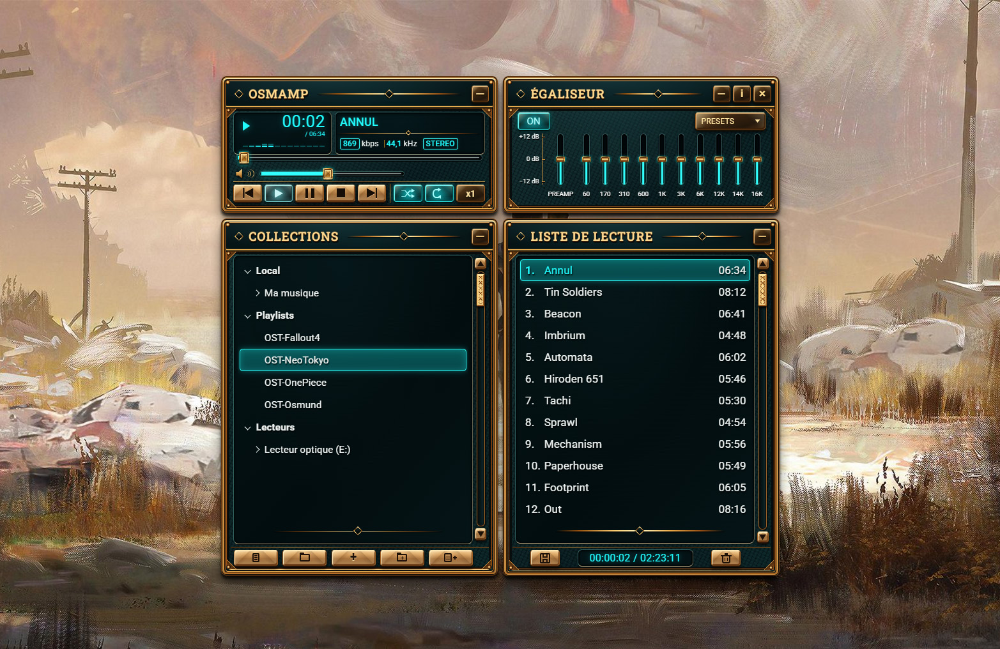

# Osmamp

**Le plaisir de mettre du son, tout simplement.**

Osmamp est un lecteur audio gratuit et léger pour Windows, inspiré de l'âge d'or des lecteurs multimédias des années 1990 et 2000, à une époque où les logiciels avaient encore une personnalité bien à eux.

Initialement conçu sous le nom de Radio Osmund, pour accompagner l'univers littéraire et musical des *Arcanes d'Osmund*, sur le site de son auteur, il est devenu une application autonome, destinée à tous ceux qui apprécient les lecteurs audio à la fois compacts, fonctionnels et visuellement singuliers.

Avec son architecture modulaire, Osmamp rend hommage à l'esprit de Winamp sans chercher à en être un clone, grâce à son esthétique rétro-industrielle, ses ornements de laiton, ses afficheurs cyan, et… ses effets sonores.

[Télécharger Osmamp 1.0.2 pour Windows x64](./Osmamp-1.0.2-Setup-x64.exe?raw=true)

## Principales fonctionnalités

- Lecture de fichiers audio locaux, avec prise en charge du WMA.
- Égaliseur à dix bandes avec préamplification.
- Visualisation du spectre audio en temps réel.
- Gestion des playlists et des collections musicales.
- Lecture aléatoire et répétition.
- Gestion de la vitesse de lecture (x1, x1,5, x2).
- Interface modulaire et personnalisable.
- Interactivité visuelle et sonore.
- Fonctionnement local, sans compte utilisateur, abonnement ni service de streaming imposé.
- Installeur léger de seulement 4,2 Mo pour la version 1.0.0.
- Aucun transfert de données, juste du fun.

## Sous le capot

Osmamp est développé à partir de technologies web (HTML, CSS et JavaScript), associées à Tauri 2, Rust et Microsoft WebView2. Cette architecture permet de concilier liberté graphique, légèreté et intégration native à Windows.

## Philosophie

Osmamp ne cherche pas à devenir une plateforme multimédia universelle. Il ne souhaite ni révolutionner notre manière d'écouter de la musique, ni multiplier les fonctionnalités au détriment de l'expérience utilisateur. C'est simplement un lecteur audio qui fait ce qu'on attend de lui, avec un peu de caractère en prime.

## À propos de l'auteur

Osmamp est une création de René Drouin, auteur, designer graphique et concepteur web, réalisée avec l'assistance de ChatGPT et Codex.

## Licence et distribution

Osmamp est un logiciel propriétaire distribué gratuitement (freeware), sans publicité, abonnement ni limitation de durée. Son utilisation est autorisée dans un cadre personnel comme professionnel. Son code source n'est pas distribué publiquement.

Osmamp s'appuie sur plusieurs technologies open source, dont Tauri et Rust, dont les licences respectives sont conservées et respectées.

2026 René Drouin — Tous droits réservés sur les éléments originaux du logiciel.

[Licence d’Osmamp](./LICENSE.md) · [Licences des composants tiers](./THIRD-PARTY-LICENSES.md)
